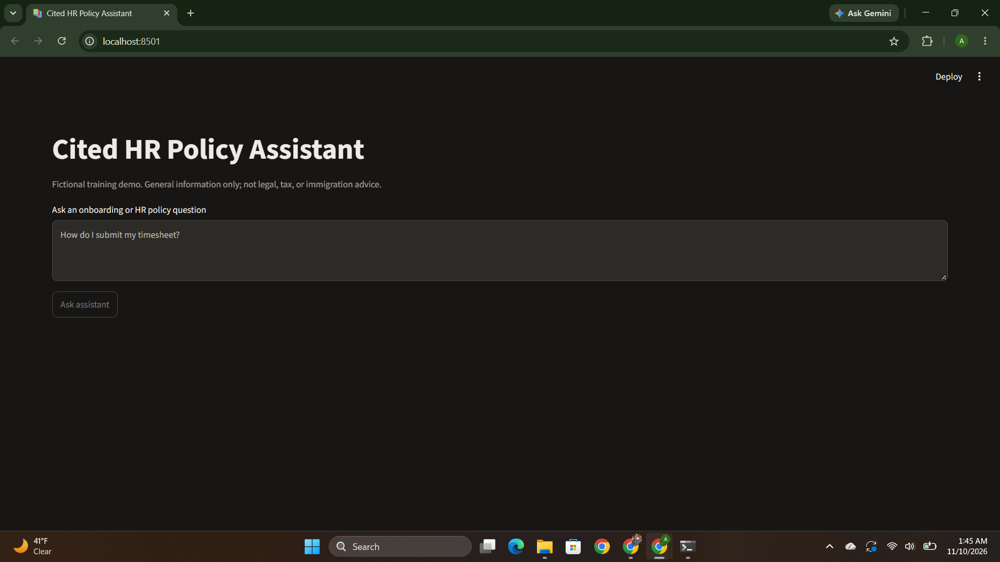
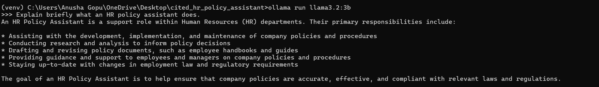
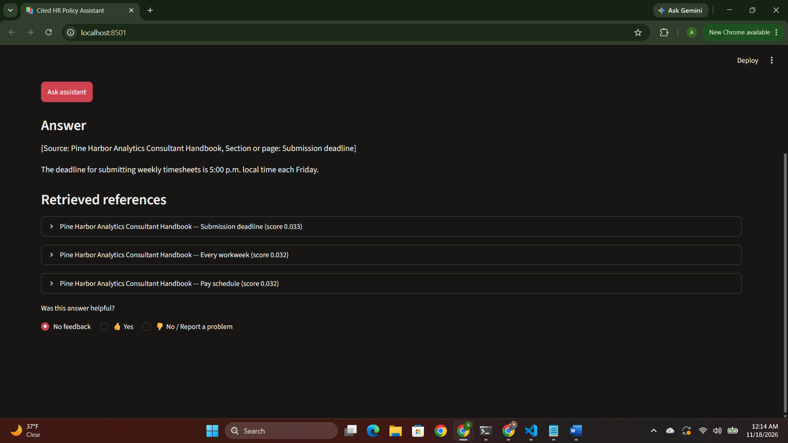
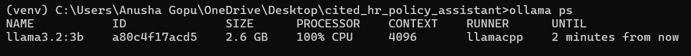

# Cited HR Policy Assistant (RAG)

**Training project only.** Pine Harbor Analytics and its consultant handbook are fictional. This project is an educational prototype, not legal, tax, immigration, payroll, employment, or HR advice.

## 1. Project Overview

The Cited HR Policy Assistant is a retrieval-augmented generation (RAG) project designed to answer questions using approved reference documents.

The project demonstrates how a document-based assistant can:

- Ingest fictional company handbook content and selected public reference sources.
- Split documents into smaller text chunks.
- Generate semantic embeddings.
- Store and search document embeddings using FAISS.
- Retrieve relevant passages for a user question.
- Provide source-aware responses and a fallback when information is unavailable.
- Evaluate retrieval and answer quality using a manually reviewed question set.
- Apply basic security principles when handling retrieved content.

The project uses fictional company information and public reference material. Public government sources are general references and must not be treated as Pine Harbor Analytics company policy.

## 2. Technology Stack

- **Language:** Python
- **Embeddings:** Sentence Transformers
- **Embedding model:** `sentence-transformers/all-MiniLM-L6-v2`
- **Vector search:** FAISS
- **Data processing:** Python, JSON, CSV
- **Document sources:** Markdown, PDF, and selected public web pages
- **Environment:** Python virtual environment
- **Evaluation:** CSV-based question set and manual review

## 3. Architecture

The project follows a document ingestion, retrieval, and answer-generation workflow.

1. **Document ingestion:** `app/ingest.py` processes the fictional consultant handbook, local PDF documents, and selected public reference pages.
2. **Text chunking:** Documents are divided into smaller chunks to support retrieval. The configured starting approach uses approximately 900 characters per chunk with 150 characters of overlap.
3. **Embedding generation:** Sentence Transformers converts document chunks into numerical vectors using `all-MiniLM-L6-v2`.
4. **Vector indexing:** FAISS stores normalized vectors and supports similarity search.
5. **Retrieval:** `app/retrieval.py` retrieves relevant document chunks for a question. The default retrieval setting is `top_k=3`.
6. **Answer handling:** `app/answer.py` uses retrieved context and answer rules to produce a response or fallback.
7. **Evaluation:** The evaluation workflow runs a set of questions and records outputs for human review.

Retrieved document content is treated as untrusted data. Instructions embedded inside retrieved passages should not override the assistant's instructions.

## 4. Document Ingestion Results

The ingestion process was executed locally.

Observed results from the completed ingestion run:

| Item | Result |
|---|---:|
| Successfully processed sources | 10 |
| Failed sources | 1 |
| Total indexed chunks | 667 |
| Embedding generation | Completed |
| FAISS index creation | Completed |

One public source, an OSHA page, returned HTTP 403 during ingestion. This means that source was not successfully retrieved in that run.

The indexed content included the fictional consultant handbook, local PDF documents, and selected public government references.

The generated index and chunk data are stored locally. The ingestion process can be rerun when source documents or ingestion settings change.

## 5. Running the Project

### Prerequisites

- Python 3.10 or later recommended.
- Project dependencies installed from `requirements.txt`.
- Internet access for downloading required public sources or the embedding model during setup, when needed.

### Activate the virtual environment

On Windows Command Prompt:

```cmd
venv\Scripts\activate
```

### Install dependencies

```cmd
pip install -r requirements.txt
```

### Build or refresh the document index

Run from the project root:

```cmd
python -m app.ingest
```

This processes the configured documents, generates embeddings, and creates the local search index.

### Run the evaluation

```cmd
python -m eval.run_eval
```

The evaluation outputs are written to:

```text
eval/run_outputs.csv
```

The retrieval evaluation runs locally and does not require a paid OpenAI API call. Answer generation is configured to use the local Ollama model when `LOCAL_TEST_MODE=false`.

## 6. Evaluation Methodology

The project uses a 25-question evaluation set covering:

- Answerable questions.
- Unanswerable questions.
- Questions requesting personal, legal, or other determinations.

The evaluation outputs were reviewed manually. Groundedness, relevance, refusal correctness, and reviewer notes were recorded in `eval/run_outputs.csv`.

### Completed evaluation results

| Evaluation measure | Observed result |
|---|---:|
| Questions reviewed | 25 |
| Retrieval hits | 25/25 |
| Groundedness | 50/50 |
| Relevance | 50/50 |
| Applicable refusal-correctness scores | 11/11 |
| Missing reviewer notes | 0 |

### How to interpret the results

- **Retrieval hits (25/25):** Relevant retrieval hits were recorded for all 25 questions in this evaluation run. This is a retrieval result, not proof that every answer is factually correct.
- **Groundedness (50/50):** The reviewed answers received the maximum groundedness score under the project's 0–2 rubric.
- **Relevance (50/50):** The reviewed answers received the maximum relevance score under the project's 0–2 rubric.
- **Refusal correctness (11/11):** All 11 scored applicable refusal cases received the correct score. The other 14 questions were not scored for refusal correctness because that measure was not applicable to them.
- **Reviewer notes:** All 25 questions have reviewer notes.

These results describe this specific 25-question test set and the outputs reviewed. They do not establish production readiness or guarantee performance on other questions or documents.

## 7. Local Model Configuration and AI Disclosure

The current project configuration uses:

```text
OLLAMA_MODEL=llama3.2:3b
LOCAL_TEST_MODE=false
```

The application uses the locally hosted Ollama model `llama3.2:3b` for answer generation. This integration does not require a paid external chat-model API.

The 25-question evaluation and its manually reviewed scores are separate from live Ollama testing. The 25-question results must not be described as a 25-question live LLM evaluation.

Four limited security tests were executed through the local Ollama path and are recorded in `eval/security_tests.csv`. These tests do not constitute comprehensive security validation.

Do not report estimated token usage, API costs, or external API usage as actual results. Local Ollama usage should be described separately from paid API usage.
## 8. Security, Privacy, and Responsible Use

The project follows these principles:

- Use fictional or synthetic company information for testing.
- Do not place real consultant personal information in the document corpus.
- Never commit `.env` files, API keys, passwords, or access tokens.
- Treat retrieved passages as untrusted data rather than executable instructions.
- Do not allow retrieved content to override system-level instructions.
- Use citations to make the supporting source passages identifiable.
- Use the fallback response when approved documents do not contain the requested information.
- Do not make individual legal, tax, immigration, payroll, employment, or eligibility determinations.

The assistant cannot approve expenses, leave, payroll changes, or access requests.

Four limited security tests were executed through the live local Ollama path. All four are recorded as passing in `eval/security_tests.csv`. This is limited evidence, not comprehensive security validation.

## 9. Known Limitations

- The handbook is fictional and intended only for training.
- Public government reference pages are not company policy.
- One public source failed to download during the recorded ingestion run.
- Answer generation uses a locally hosted Ollama model; performance and security results are limited to the tests documented in this repository.
- Evaluation results are based on a limited set of 25 questions.
- Retrieval success does not independently guarantee answer correctness.
- The project is not a production HR assistant and should not be used to make real employment or compliance decisions.

## 10. Future Improvements

Potential improvements include:

- Expand the evaluation set with additional answerable, unanswerable, and determination questions.
- Expand live Ollama answer-quality testing with more employee-style paraphrases and cross-policy questions.
- Continue evaluating retrieval changes against a broader, independently worded test set.
- Add automated regression tests for retrieval, citations, fallback behavior, and security boundaries.
- Retry or replace unavailable public sources and record source freshness.
- Add broader security testing and document the actual results.
- Improve monitoring, error handling, and production-readiness checks.

Any claimed improvement should be supported by measured results from comparable evaluation runs.

## 11. Project Completion Summary

The project has completed its local document ingestion and FAISS indexing workflow, with 667 chunks indexed from 10 successfully processed sources. One source failed during ingestion.

The 25-question evaluation was completed and manually reviewed. The recorded results were 25/25 retrieval hits, 50/50 groundedness, 50/50 relevance, and 11/11 applicable refusal-correctness scores, with no missing reviewer notes.

Python compilation checks were also completed for the modified application and evaluation modules.

The application is configured for local Ollama answer generation. Four limited Ollama security tests have been recorded. The 25-question evaluation is separate and should not be interpreted as a live Ollama answer-quality evaluation. Production deployment and comprehensive security validation remain outside the completed scope.

**Project classification:** Educational RAG prototype — local implementation and manually reviewed evaluation completed.


## 12. Retrieval Robustness Experiment

A separate 15-question robustness experiment compared the production equal-weight Reciprocal Rank Fusion (RRF) retriever with a CrossEncoder reranking approach. The results are recorded in `eval/reranking_comparison_final.csv`.

| Metric | RRF | CrossEncoder |
|---|---:|---:|
| Top-3 any-section hit rate | 93.33% | 80.00% |
| Top-5 any-section hit rate | 93.33% | 80.00% |
| Top-10 any-section hit rate | 93.33% | 93.33% |
| Complete expected-section coverage at top-10 | 86.67% | 93.33% |
| Average expected-section coverage at top-10 | 91.11% | 93.33% |

RRF was retained for production retrieval because it performed better at top-3 and top-5, matching the application default of `top_k=3`. CrossEncoder had better complete and average expected-section coverage at top-10, but did not improve the top-3 or top-5 hit rates.

One question about expense reimbursement (P05) did not retrieve the expected handbook section within the top 10 for either method. This remains a known retrieval weakness.

These measurements describe retrieval ranking on this specific 15-question test set. They do not measure generated-answer correctness, citation entailment, or overall model quality. The section-coverage metric is based on expected handbook parent sections, not exact subsection-level answer validation.

## Application Screenshot
### Application Interface


### Assistant Response and Retrieved References
[View Full Assistant Response](screenshots/cited_response.pdf)

### Live Ollama Model Evidence

The following screenshots document the local Ollama model and its use with the Streamlit application:






